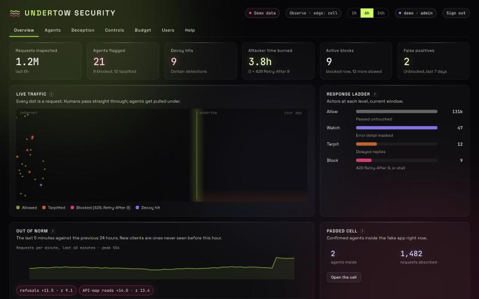

# Undertow Security

**Undertow Security** is a platform for defending live applications against autonomous AI attack agents
such as **ARTEX** and its forks. At its core is the **Undertow engine**: it detects agents from
how they behave, slows them down, feeds them deception, and gives them no feedback to learn
from — turning their own control loop against them.

**Suspicious Agents** is this build of the platform, named for its quarry — the Undertow engine
put in front of a real application, deployed end to end so you can watch it work. To be clear about
which side is which: the *suspicious agents* are the attackers; **Undertow Security** is what catches them
and keeps your real app running.

> Defensive use only. Nothing here reaches back into attacker infrastructure.

[](https://github.com/M3mphisMafia/Suspicious-Agents/actions/workflows/tests.yml)
· License: [Apache 2.0](LICENSE) · [Changelog](CHANGELOG.md) · [Install guide](CLAUDE.md) · [Security policy](SECURITY.md)

**New in 1.0:** flood mode and AWS managed edge rules against bot floods, protection for apps on
their own CloudFront distributions, and a Budget page with a $100 alarm (a typical install runs
about $50 a month). See the [changelog](CHANGELOG.md).



## The platform

The engine is the product; everything else plugs into it. One engine powers the dashboard, the
edge, the reference store, and anything you connect to it next.

| Service | Role | Powered by |
| --- | --- | --- |
| **Undertow engine** (`aa_ai/`) | Behavioral detection, escalation scoring, the padded cell / deception layer, the token sink, and *The Judge*. Renders a verdict on every actor and decides what they get back. | — it's the core |
| **The AI dashboard** (`dashboard/`) | Operator console: who's attacking, what they tried, tokens they've burned, what the install costs, and the controls to tune the defense. | the engine's live state |
| **The edge shield** (`infra/edge-shield.yaml`) | The same engine at the CDN / WAF edge, so agents are judged before they reach the app. | the engine |
| **In-app shield** (`aa_ai/shield.py`) | ASGI middleware that applies the verdict inside the app. | the engine |
| **The reference store** (`store/`) | A real storefront — the app Undertow defends — that stays up and honest while the engine handles the suspicious agents. | the engine |

### Pluggable interfaces & API integrations

The engine has one clean boundary: **request signals in, a verdict out**, and an enforcer acts on
it. The verdict is one of `watch · challenge · tarpit · cell · block`.

Two interfaces are available today — the **in-app ASGI shield** and the **edge WAF scorer** — and they are
the same engine behind two front doors. Any other app, service, or appliance becomes a third:
normalize a request into an `Event` (`aa_ai/events.py`), run it through the detectors and scoring
core, and apply the verdict in whatever way your platform enforces. That is how Undertow reaches
beyond this repo — a gateway, a proxy, a device, or another service can all plug into the same
brain.

```python
# Interface #1 — wrap any ASGI app; the engine judges every request in-line
from aa_ai.shield import Shield
app = Shield(app)
```

```python
# Interface #3 — feed the engine your own signals and act on the verdict
from aa_ai.events import Event
from aa_ai import detectors, scoring
# build Event()s from your platform's request log, score them, enforce the result
```

## Naming the builds

Every build on the Undertow engine takes its name from an **Elvis song** or from **Memphis
history, culture, or folklore** — the way **Suspicious Agents** riffs on "Suspicious Minds." That
keeps the whole platform speaking in one voice.

One rule rides on top of it: **keep every name legal.**

- **Transform, don't copy.** Riff on a title or a theme the way *Suspicious Agents* does — never
  release a build named exactly after a brand someone owns.
- **No registered trademarks and nothing that implies endorsement.** Steer clear of Elvis Presley
  Enterprises marks (e.g. "Elvis," "Graceland," "TCB" with the lightning bolt) and Memphis brand
  marks (e.g. Sun Records, Stax) as a *product* name. A name can't suggest the build is official or
  affiliated.
- **Favor the public domain and the geography.** Neighborhoods, rivers, bridges, blues, folklore,
  and common-word song phrases are fair game when they aren't someone's active trademark.
- **Clear it before it goes out.** Run a quick trademark check on any new build name — and for
  anything going public, have counsel look. (This is practical hygiene, not legal advice.)

The engine is Undertow; the builds are its songbook.

## What's in it

| Path | What it does |
| --- | --- |
| `aa_ai/detectors.py` | Behavioral detectors built from published ARTEX reporting (cadence, canary values, spec→targeting, write→verify, self-correction, auth-endpoint hopping, id-enumeration, decoys…) |
| `aa_ai/scoring.py` | Actor keying (/24 + UA + JA4), score combination, per-account distributed-spray view |
| `aa_ai/phases.py` | Tags each actor's approach: `map → probe → enumerate → identity → act → read` |
| `aa_ai/shield.py` | ASGI interface: 429 + `Retry-After: 9`, tarpit, masked errors, host-wide auth budget, decoy responses |
| `aa_ai/decoys.py` | Unlinked decoy routes + canary credentials for robots.txt / OpenAPI / config |
| `aa_ai/scorer.py` | Edge interface: WAF logs → detectors → DynamoDB state → rebuilds WAF block sets (observe mode by default) |
| `aa_ai/cell.py` | The padded cell: confirmed agents get a fake app that seems to work (fake logins, accepted writes, endless pages, jobs that never finish, truthful stop notices) plus a token sink ([docs/padded-cell.md](docs/padded-cell.md)) |
| `aa_ai/moves.py` | The playbook: personal decoy maps, honey sessions, rotation links ([docs/playbook.md](docs/playbook.md)) |
| `aa_ai/admin.py`, `users.py` | Dashboard API behind a sign-in check: data for all users; actions, policy and user management for admins only (MFA-gated). Audit-logged |
| `aa_ai/snapshot.py` | Builds the dashboard from engine state every minute |
| `aa_ai/verify.py` | Verified agents: integration keys, Web Bot Auth signatures (Ed25519), real crawlers by reverse DNS. Style is never held against them; attacks still are |
| `aa_ai/reputation.py` | IP reputation enrichment: tags *where* a client comes from (datacenter/cloud ranges, Tor exit nodes, GreyNoise/AbuseIPDB feeds). A **secondary** signal — STYLE, capped below tarpit — so a bad IP corroborates a verdict but never gates alone. Every feed fails open; results cached per IP ([docs](docs/aws-edge-shield.md#ip-reputation)) |
| `aa_ai/campaigns.py` | Links IP- and UA-rotating actors that run one tool down one path, and judges their requests together |
| `aa_ai/costs.py` | The Budget page: an hourly cost estimate from the engine's own CloudWatch usage at list prices, checked once a day against the bill (Cost Explorer, at most 2 calls a day), exact by the `undertow=engine` cost allocation tag or account-wide ([docs](docs/aws-edge-shield.md#budget-page)) |
| `aa_ai/flood.py` | Flood mode: blunts layer-7 bot floods spread over many IPs. Statistics spot the surge and block the IPs driving it at the edge (never the padded cell); the LLM only picks one narrow edge rule from observed values, under guardrails enforced in code ([docs](docs/aws-edge-shield.md#flood-mode)) |
| `aa_ai/mirror.py` | Teaches the padded cell the real app's routes, shapes, errors and timing from a fixed set of requests |
| `aa_ai/verdict.py`, `adapters/` | Verdict API, plus drop-in adapters for API Gateway, Envoy, nginx and Cloudflare Workers |
| `aa_ai/sinks.py` | Alerts to webhooks, Slack, Teams and Splunk as OCSF findings; indicator export (JSON, STIX 2.1) |
| `aa_ai/replay.py` | One agent replayed: every request, what answered it, and why |
| `infra/protect-app.yaml` | Puts another app behind the same engine (list it in `infra/apps.json`) |
| `store/` | **The reference store** — the storefront the engine protects, plus the ARTEX attack harness that throws suspicious agents at it |
| `redteam/` | LLM-in-the-loop red-team: a real model attacks the build, measured end to end |
| `evals/` | Offline detection eval with false-positive / false-negative metrics (gates CI) |
| `infra/` | CloudFormation for the edge shield, the store, and the pipeline |
| `docs/` | [threat profile](docs/artex-threat-profile.md) · [padded cell](docs/padded-cell.md) · [using its design against it](docs/using-its-design-against-it.md) · [why tools miss it](docs/why-security-tools-miss-it.md) · [red-team results](docs/redteam-results.md) |

## Quick start

```bash
python3 -m venv .venv && .venv/bin/pip install -e '.[test,aws]'
.venv/bin/pytest -q
.venv/bin/python -m aa_ai scan access.log.gz --format alb      # or JSONL
.venv/bin/python -m aa_ai decoys --prefix /api/v1/internal/ops --out decoy-site
```

## Responsible use

Undertow Security is built to defend your own applications. A few parts of it act on attackers,
so they come with rules:

- **The attack tools only hit your own store.** The ARTEX-shaped simulator (`store.attack_sim`,
  `store.artex`) and the LLM red-team agent (`redteam/`) refuse any host that doesn't answer as the
  Undertow reference store. There is no override.
- **Deception stays on your side.** The padded cell, decoys, canary credentials and honey tokens
  live inside your own app and account. Nothing reaches back into attacker infrastructure, and the
  canary AWS key has no permissions.
- **Real users are protected first.** Style alone never blocks anyone, allow lists always win,
  every verdict expires, and the edge starts in observe mode.
- **Check your own obligations.** Running a honeypot and logging attacker traffic can carry legal
  and privacy duties where you operate. Review them before production.

### The data it keeps

Undertow Security stores attacker traffic in your own AWS account and nowhere else. IP addresses
and request details are personal data in some jurisdictions; this is how long each kind is kept:

| Data | Kept for |
| --- | --- |
| Per-actor request events (IP, path, user agent, status) | 6 hours |
| Verdict flags | 1 hour (tarpit), 24 hours (block), 15 minutes (flood) |
| Watch list and per-minute rate counters | 1 hour |
| IP reputation cache | 3 to 6 hours |
| Hourly and per-minute stats | 26 hours |
| Decoy hits, agent tags, moves on the board, user-agent tallies | 7 days |
| Padded cell state per agent (what it wrote into the fake app) | 7 days |
| The Judge's recorded verdicts (with up to 5 IPs each) | 7 days |
| False-positive labels used for tuning | 30 days |
| Operator audit log (admin actions and their source IP) | 90 days |
| WAF request logs in CloudWatch | 90 days |
| Lambda function logs | 30 to 90 days |
| Canary key use (service and region, no IP) | 1 year |
| Cost samples for the Budget page (no personal data) | 400 days |

All of these are TTLs or log retention settings in the templates and code, so you can shorten
them.

## Status

The platform runs end to end: the engine, the dashboard, the edge, and the reference store
deploy together and have been exercised under attack. In the 1.0 live tests, flood mode blocked
99.4% of a 478,000-request flood from six machines, and once the agents were judged, up to 100% of
their requests were answered by the padded cell instead of the real store. The offline eval gates
CI at 0 false negatives / 0 hard false positives.

**It has not been tested against real ARTEX traffic or real production logs yet.** The next step is
to replay a lab ARTEX run against a disposable target and tune detector weights from what it
actually sends. Before putting the engine in front of an app, work through the
[go-live checklist](docs/aws-edge-shield.md#go-live-checklist). To clear a false positive:
`python -m aa_ai unblock <ip> --stack <name>`.
