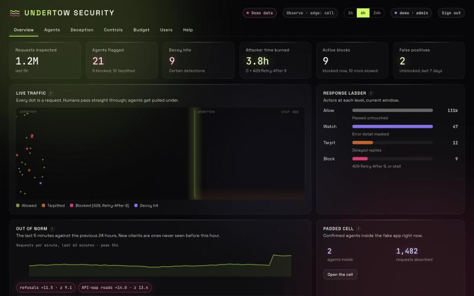

# The live Dashboard

The **Dashboard** tab (new in 1.1.0) is a full-screen, animated picture of the edge. Every light is
a real request the WAF saw, replayed about a minute after it happened. You watch traffic arrive
from the internet, meet the Undertow line, and either pass into your app, bounce off, wait, crawl,
or get pulled under into the padded cell.

It is the tab the console opens on. Reloading the page keeps you on whichever tab you were on.

## What the motion means

The scene reads left to right: the internet, the Undertow line (the edge), and your app, split
into lanes. The decoys sit above the app and the padded cell below it.

| Class | What happened | What you see |
| --- | --- | --- |
| Allowed | An ordinary request | Flows through the line into its lane |
| Verified | A verified crawler or signed agent | Flows through, marked as verified |
| Watch | A client near the line, still served normally | Passes, but glows |
| Challenge | The WAF served a silent browser challenge | Pauses at the line, then passes |
| Tarpit | A suspect being slowed | Crawls through the line |
| Padded cell | A confirmed agent sent to the fake app | Pulled down into the cell pool: the undertow |
| Blocked | An agent rule answered 429 | Bounces off the line |
| Flood | A flood source or flood rule stopped it | Breaks against the line as a wave |
| Decoy | A decoy route, canary or honey token was touched | Diverted up into the decoys |

Every class also has its own color from a palette checked for color blindness, but color is never
the only cue: motion, position, the legend and the tooltip all say the same thing. Hover or click
a light to see its time, class, app, lane, method and path, country, agent tag and IP.

Colors show **Undertow's verdict on the client**. A brand-new IP from an agent already confirmed
can show as padded cell up to a minute before the edge routes that IP there.

## Making it yours

- **Lanes.** Open "Add to the scene" and drag in the parts of your app you care about: login and
  accounts, API, search, checkout, admin, pages and assets, or a whole protected app. Each one
  becomes a lane on the right, and its traffic flows into it. Everything else lands in
  "everything else". Reorder or remove lanes at any time.
- **Widgets.** Drop live stat cards anywhere on the scene: requests per minute, agents flagged,
  agents in the padded cell, attacker tokens burned, flood mode status, budget this month, top
  agents, recent moves and decoy hits. Drag to move, close to remove.
- **Highlight.** Click a class in the legend to light it up while everything else dims ("Show
  all"), or switch to "Only the chosen class" to hide the rest.
- **Full screen.** The Full screen button fills the display; Esc leaves.
- **Refresh.** The scene's own ↻ Refresh loads the latest minute right away, in full screen too.
  The ↻ Refresh at the top of the console does the same for whichever tab is open.

The layout is saved in your browser, so each operator keeps their own view.

## Where the data comes from

The scene runs on a **sample**, not every request, which keeps it cheap even during a flood:

1. Each batch of WAF logs the scorer reads keeps at most **40 requests**: 16 rare ones (decoy hits,
   known agents, challenges, verified clients), 8 from flood sources and 16 of everything else.
   Rare kinds come first, so a flood can't crowd a decoy hit out of the picture.
2. Each batch writes **one** DynamoDB row (`LIVE#<minute>`, kept 2 hours), never one per request,
   and a minute stops collecting at **400** sampled requests.
3. The 1-minute tick turns the last **3 minutes** into `data/live.json` (at most **300** events,
   balanced across classes, newest first), with per-minute estimates of each class and lane,
   scaled from the sample to the real request count.
4. The page fetches it once a minute and replays the events at their real relative timing. In
   the first live run the feed ran about **62 seconds** behind.

**Why not Firehose?** The scorer already reads every WAF log record, so a sample costs a few CPU
steps per request and one row per batch. Kinesis Data Firehose would add a stream and a per-GB
charge to deliver data the engine already has. It becomes worth it if you want every request kept
for long-term replay or analysis; WAF logs in CloudWatch already keep the full records for 90 days.

**Cost.** Estimated at under $2 a month even at the sample's ceiling: one small DynamoDB row per
log batch and one extra S3 write a minute. That is worked out from item sizes, not yet read off a
bill; the Budget page includes these writes in its estimate.

## Who sees what

The live feed carries IP addresses, so only **admins signed in with MFA** receive it, through the
signed-in data API. CloudFront never serves `data/` publicly. Viewers, and anyone opening the page
from disk, see clearly labeled **demo traffic** built from documentation IP ranges.

## Accessibility

Every control works from the keyboard. A text view lists the counts and the latest requests. With
reduced motion turned on in the operating system, the scene stays still and shows the per-class
and per-lane counts instead.

## Known limits

- It is a sample. Counts are estimates; the WAF logs hold the full record.
- It runs about a minute behind real time.
- Mouse drag-and-drop and the Fullscreen API have been checked through their keyboard and click
  equivalents; Safari and phones are untested so far.

## Files

| Path | What it does |
| --- | --- |
| `aa_ai/live.py` | Sampling, classes and lanes, and `live.json` assembly |
| `aa_ai/scorer.py` | Keeps the sample during ingest; the tick publishes the feed |
| `aa_ai/admin.py` | The admin-only route that serves the feed |
| `dashboard/live.js`, `dashboard/live.css` | The scene |
| `infra/upload_dashboard.sh` | Publishes every dashboard file with its content type |
| `tests/test_live.py` | Sampling bounds, classification, the feed and the route |
